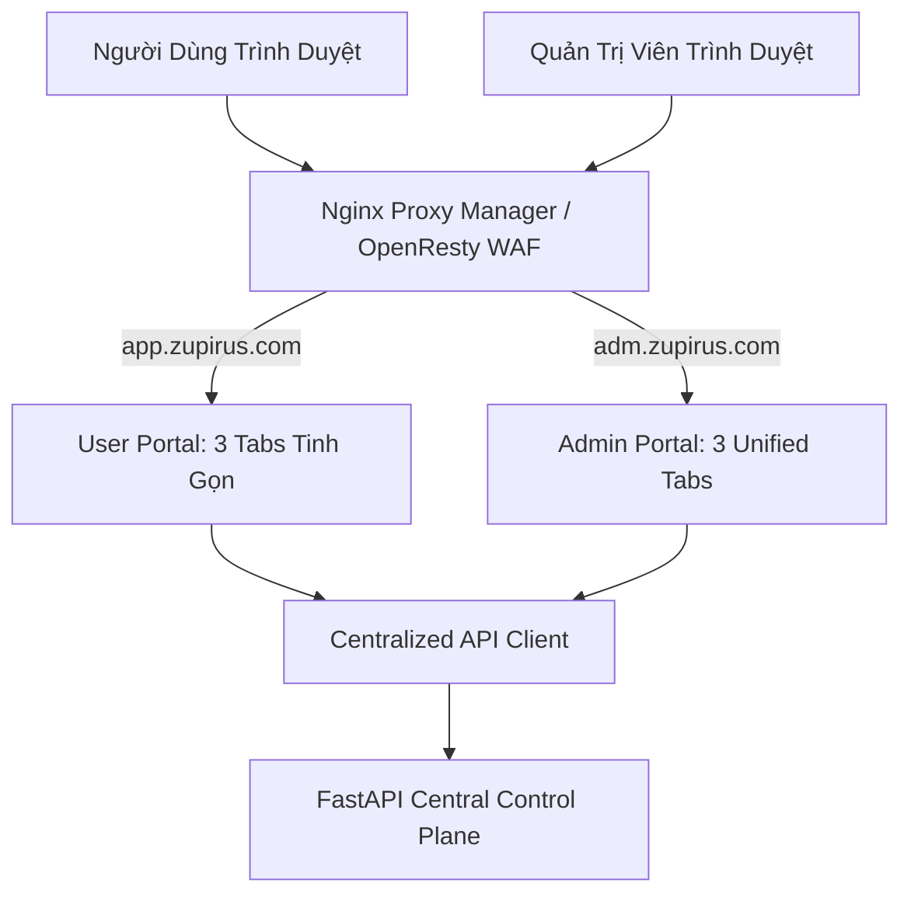
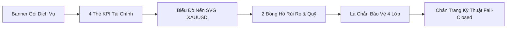
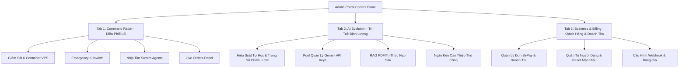

# BẢN ĐỒ TỔNG THỂ TÍNH NĂNG VÀ GIAO DIỆN HỆ THỐNG ZUPIRUS QUANT LAB (v1.2.1)
> **Phiên bản:** v1.2.1-PROD  
> **Cập nhật ngày:** 22/11/2026  
> **Phạm vi:** Toàn bộ giao diện Người dùng (`app.zupirus.com`) và Cổng Quản trị Viên (`adm.zupirus.com`)  
> **Ngôn ngữ thiết kế:** Glassmorphism 2026, Bento Grid (`SpotlightBento`), Typography `Be Vietnam Pro` & `JetBrains Mono`

---

## MỤC LỤC TỔNG QUAN

1. [KIẾN TRÚC VÀ CẤU TRÚC GIAO DIỆN CHUNG](#1-kiến-trúc-và-cấu-trúc-giao-diện-chung)
2. [CỔNG NGƯỜI DÙNG — USER PORTAL (app.zupirus.com)](#2-cổng-người-dùng--user-portal-appzupiruscom)
   - [2.1 Khung Vỏ & Điều Hướng (PortalChrome)](#21-khung-vỏ--điều-hướng-portalchrome)
   - [2.2 Tab 1: Tổng Quan Định Lượng (UserOverviewTab)](#22-tab-1-tổng-quan-định-lượng-useroverviewtab)
   - [2.3 Tab 2: Quản Trị Trạm Đầu Cuối MT5 (UserAccountsTab)](#23-tab-2-quản-trị-trạm-đầu-cuối-mt5-useraccountstab)
   - [2.4 Tab 3: Sổ Lệnh & Phân Tích Thực Thi (UserOrdersTab)](#24-tab-3-sổ-lệnh--phân-tích-thực-thi-userorderstab)
3. [CỔNG QUẢN TRỊ VIÊN — ADMIN PORTAL (adm.zupirus.com)](#3-cổng-quản-trị-viên--admin-portal-admzupiruscom)
   - [3.1 Tab 1: Trung Tâm Radar & Điều Phối Lõi (AdminCommandRadarTab)](#31-tab-1-trung-tâm-radar--điều-phối-lõi-admincommandradartab)
   - [3.2 Tab 2: Tiến Hóa AI & Tri Thức Định Lượng (AdminAIEvolutionTab)](#32-tab-2-tiến-hóa-ai--tri-thức-định-lượng-adminaievolutiontab)
   - [3.3 Tab 3: Doanh Nghiệp, Khách Hàng & Cổng Thanh Toán (AdminBusinessCustomersTab)](#33-tab-3-doanh-nghiệp-khách-hàng--cổng-thanh-toán-adminbusinesscustomerstab)
4. [BẢN ĐỒ LIÊN KẾT API & ĐIỂM CUỐI DỮ LIỆU](#4-bản-đồ-liên-kết-api--điểm-cuối-dữ-liệu)

---

## 1. KIẾN TRÚC VÀ CẤU TRÚC GIAO DIỆN CHUNG

Hệ thống được phát triển theo mô hình Single Page Application (React 19 + Vite 8 + TypeScript + Tailwind CSS) phục vụ đồng thời cả hai vai trò thông qua cơ chế phân quyền RBAC và chuyển đổi ngữ cảnh tự động theo tên miền hoặc URL parameters:
- **`app.zupirus.com`**: Phục vụ các nhà đầu tư cá nhân, quỹ Prop Trader và khách hàng ủy thác.
- **`adm.zupirus.com`**: Phục vụ Kỹ sư Quản trị Lõi (SRE), Chuyên gia Định lượng (Quant) và Quản lý Vận hành.

---

## 2. CỔNG NGƯỜI DÙNG — USER PORTAL (`app.zupirus.com`)

Giao diện người dùng được chuẩn hóa theo tiêu chuẩn **Glassmorphism 2026** với nền tối vi lượng `#040710`, toàn bộ thẻ khối ứng dụng `<SpotlightBento>` có hiệu ứng quầng sáng động theo con trỏ chuột, đường viền nano `white/[0.08]` và độ mờ nền `backdrop-blur-xl`.

### 2.1 Khung Vỏ & Điều Hướng (`PortalChrome.tsx`)
- **Header Thanh Điều Hướng (Top Navigation Bar):**
  - **Logo Thương Hiệu:** Nhãn kính `ZUPIRUS QUANTUM OS v5.0` kèm đèn trạng thái xanh ngọc nhịp thở.
  - **Trạng thái Trạm VPS:** Hiển thị độ trễ trực tiếp đến trung tâm hạ tầng London (`London G2 · 30.8ms`).
  - **Thước Đo Giá Sống (Realtime Price Ticker):** Hiển thị cặp `XAU/USD $3,539.00` tự động nhảy theo luồng SSE.
  - **Thẻ Hồ Sơ Người Dùng (User Profile Badge):** Thể hiện email khách hàng, huy hiệu gói dịch vụ (`STARTER`, `GROWTH`, `ALPHA`) và nút chuyển nhanh Đổi Mật Khẩu / Đăng Xuất.
- **Thanh Bên Mở Rộng / Thu Gọn (Sidebar Desktop 1440px):**
  - Chiều rộng linh hoạt: 264px khi mở rộng, thu gọn về 76px khi bấm icon thu nhỏ.
  - 3 Mục Menu Chính:
    1. **Tổng Quan (Overview):** Biểu đồ nến trực tiếp, PnL, đồng hồ quỹ và lá chắn 4 lớp.
    2. **Tài Khoản (Terminals):** Quản lý kết nối MT5, trạm Cloud và hóa đơn SePay.
    3. **Sổ Lệnh (Orders):** Lịch sử khớp lệnh, tỷ lệ thắng, tỷ lệ Risk/Reward (R-Multiple).
- **Thanh Điều Hướng Nổi Trên Thiết Bị Di Động (Mobile Floating Dock 390px):**
  - Neo cố định ở đáy màn hình với đệm an toàn `pb-[120px]` trong thân trang, không che khuất nút thao tác.
  - 3 icon tab cảm ứng với phản hồi rung và hiệu ứng neon active.
- **Hộp Lệnh Nhanh (Command Palette - `Ctrl + K` / `Cmd + K`):**
  - Tìm kiếm nhanh các chức năng, chuyển tab tức thì.
  - Kích hoạt chế độ kiểm tra khẩn cấp và tra cứu vé hỗ trợ.
- **Hộp Thoại Đổi Mật Khẩu Bảo Mật (`PasswordChangeModal`):**
  - Xác thực mật khẩu cũ và thiết lập mật khẩu mới chuẩn OWASP (tối thiểu 8 ký tự, chữ hoa, số và ký tự đặc biệt).

---

### 2.2 Tab 1: Tổng Quan Định Lượng (`UserOverviewTab.tsx`)

Bảng điều khiển trung tâm giúp nhà đầu tư nắm bắt toàn bộ dòng vốn và hoạt động thị trường trong vòng 3 giây:

#### Chi tiết các thành phần trên Tab 1:
1. **Banner Gói Dịch Vụ & Gia Hạn:**
   - Hiển thị gói cước đang hoạt động, số ngày và giờ sử dụng còn lại (cảnh báo viền vàng khi $\le 7$ ngày).
   - Nút `Nâng Cấp / Gia Hạn Ngay` tự động dẫn đến cổng thanh toán VietQR.
2. **Hàng 4 Thẻ KPI Tài Chính Định Lượng (SpotlightBento Cards):**
   - **Tổng Vốn Ròng (Net Equity):** Tổng số dư thả nổi thực tế trên tất cả tài khoản MT5, tính theo USD (hoặc quy đổi sang VNĐ).
   - **Lợi Nhuận Hôm Nay (Daily PnL):** Lãi/lỗ ròng đã chốt trong ngày tính theo USD và phần trăm (hiển thị màu xanh ngọc khi lãi, đỏ thẫm khi âm).
   - **Tỷ Lệ Thắng (Win Rate):** Tỷ lệ lệnh thắng gần nhất kèm tổng số lệnh đã đóng.
   - **Khối Lượng Mở (Open Positions / Lot Exposure):** Tổng khối lượng Lot vàng đang giữ trên thị trường.
3. **Biểu Đồ Nến SVG Thời Gian Thực (`CandlestickTelemetryChart.tsx`):**
   - Vẽ nến trực tiếp thông qua luồng dữ liệu định lượng (`quotes`), hỗ trợ chuyển đổi khung thời gian: **M1, M5, M15, H1**.
   - Thước đo giá thời gian thực: Hiển thị giá `Bid`, giá `Ask` và chênh lệch `Spread (pips)`.
   - Huy hiệu định danh nguồn cấp dữ liệu: `DB_QUOTES` hoặc `REDIS_CACHE`.
4. **Cặp Đồng Hồ Rủi Ro & Tiến Độ Quỹ (RadialRiskGauge):**
   - **Vòng 1 — Lá Chắn Cắt Lỗ Ngày (Daily Drawdown Guard):**
     - Giới hạn rủi ro tối đa cố định ở mức **4.0%/ngày**.
     - Thể hiện trực quan mức sụt giảm hiện tại, tự động chuyển màu cảnh báo từ xanh lá $\rightarrow$ vàng $\rightarrow$ đỏ rực rỡ khi chạm ngưỡng an toàn.
   - **Vòng 2 — Tiến Độ Mục Tiêu Quỹ Prop (Prop Target 8%):**
     - Đặt ngưỡng lợi nhuận mục tiêu giai đoạn thi Quỹ (Target +8.0%).
     - Tích hợp nút `🏆 Xuất Chứng Chỉ`: Khi tiến độ đạt $\ge 8.0\%$, kích hoạt `PropCertificateModal` để tải ảnh chứng chỉ hoàn thành xuất sắc thử thách thi quỹ có chữ ký số Zupirus.
     - Trường hợp tài khoản thông thường: Chuyển đổi thành thước đo độ trễ hạ tầng kết nối trạm máy chủ London G2.
5. **Thanh Trạng Thái Lá Chắn 4 Lớp (4-Layer Defense Shield):**
   - **Lớp 1 (L1) — Idempotency Lock:** Khóa lặp tín hiệu dựa trên Redis và TimescaleDB (độ trễ ~30ms).
   - **Lớp 2 (L2) — Mandatory SL & Spread:** Bắt buộc cài đặt Stop Loss tự động theo chỉ báo ATR(14) và chặn khớp khi giãn spread.
   - **Lớp 3 (L3) — News Shield USD:** Lá chắn tin tức kinh tế đỏ (FOMC, NFP, CPI), tự động dừng giao dịch trước và sau tin 15 phút.
   - **Lớp 4 (L4) — Slippage Guard:** Kiểm soát trượt giá khớp lệnh tối đa không quá 20 pips ($2.00).
6. **Dải Thông Số Kỹ Thuật Đáy Trang (Micro-strip):**
   - Thể hiện: Thời gian máy chủ VPS, Ping kết nối Redis, Ping TimescaleDB, Ping MetaApi, Tỷ lệ bảo vệ **Fail-Closed 4/4**.

---

### 2.3 Tab 2: Quản Trị Trạm Đầu Cuối MT5 (`UserAccountsTab.tsx`)

Trung tâm kết nối và cấu hình tham số bảo vệ từng tài khoản giao dịch:

#### 1. Quy Trình Kết Nối Tài Khoản MT5 Mới (`AccountModals.tsx`):
- Nút CTA lớn: `+ Kết Nối Tài Khoản MT5 Mới`.
- Form nhập liệu tham số:
  - Máy chủ Broker (Ví dụ: `Exness-Real`, `ICMarketsSC-Live`, `FTMO-Server`).
  - Số tài khoản (Login ID) và Mật khẩu (Master hoặc Investor).
  - Loại tài khoản: **Standard (Chuẩn)**, **Cent (Tài khoản Xu)**, **Prop Firm (Tài khoản Quỹ)**.
  - Tỷ lệ đòn bẩy và Hệ số phân bổ Lot (Lot Multiplier: 0.1x – 5.0x).
  - Ngưỡng cắt lỗ ngày cá nhân hóa (Max Daily DD%: 1% – 5%).
  - Mục tiêu lợi nhuận chốt lời ngày (Daily Profit Target USD).
  - Giai đoạn Quỹ Prop: `CHALLENGE` (Vòng 1/2) hoặc `LIVE` (Tài khoản được cấp vốn).
- **Hộp thoại Ký Điều Khoản Pháp Lý (Legal Risk Disclaimer):** Khách hàng phải tick chọn xác nhận hiểu rõ cơ chế rủi ro đòn bẩy và chấp thuận ủy quyền kết nối an toàn.
- **Hộp thoại Thanh Toán Tự Động VietQR SePay:** Khi cần mua thêm slot Cloud MT5, hệ thống tự động sinh mã QR ngân hàng kèm mã thanh toán động và tự động kích hoạt tài khoản ngay khi nhận tiền.

#### 2. Danh Sách Tài Khoản Đang Hoạt Động (`ConnectedAccountsListSection.tsx`):
- Mỗi tài khoản hiển thị trong một khối `<SpotlightBento>` độc lập:
  - Thông tin máy chủ, số login, loại tài khoản.
  - Số dư (Balance), Vốn ròng (Equity), Lợi nhuận thả nổi (Floating PnL), Đòn bẩy.
  - Đèn trạng thái máy chủ Cloud: `RUNNING` (Đang chạy), `STOPPED` (Tạm dừng), `SYNCING` (Đang đồng bộ), `ERROR` (Lỗi kết nối).
- **Thao tác nhanh trên từng tài khoản:**
  - Nút **Đồng bộ**: Lấy số dư và trạng thái mới nhất từ broker.
  - Nút **Bật/Tắt Auto-Trade**: Bật tắt quyền tự động vào lệnh của thuật toán trên tài khoản này.
  - Nút **Deploy / Undeploy Cloud**: Điều phối trạm đầu cuối máy chủ MT5 ảo hóa.
  - Nút **Xóa kết nối**: Hủy lưu trữ và ngắt kết nối an toàn.
- **Ngăn Kéo Chỉnh Sửa Tham Số Bảo Vệ (In-line Protection Editor):**
  - Cho phép tinh chỉnh trực tiếp: Hệ số Lot, Mức DD tối đa/ngày, Khối lượng Lot lớn nhất cho phép trên 1 lệnh, Mục tiêu lợi nhuận đóng ngày, Bản đồ ký hiệu riêng (`Symbol Mapping` tùy theo sàn như `XAUUSDm`, `GOLD`, `XAUUSD.s`).

#### 3. Chương Trình Mời Bạn Bè & Hóa Đơn SePay (`UserReferralAndInvoicesSection.tsx`):
- **Khối Giới Thiệu (Affiliate 6 cột bên trái):**
  - Hiển thị mã giới thiệu cá nhân (`ZUP-XXXXXX`) và đường dẫn mời bạn bè có nút sao chép 1 chạm.
  - Thống kê: Số lượt bạn bè đăng ký thành công và số ngày Cloud MT5 thưởng đã tích lũy (**+7 ngày/lượt giới thiệu**).
  - Khung nhập mã giới thiệu của người khác để nhận ngay **+3 ngày trải nghiệm miễn phí**.
- **Khối Hóa Đơn Điện Tử SePay (6 cột bên phải):**
  - Lịch sử các đơn hàng thanh toán nâng cấp gói và mua thêm trạm Cloud.
  - Trạng thái đơn hàng: `PAID` (Đã thanh toán thành công) hoặc `PENDING` (Chờ quét mã).
  - Nút **`In / Tải PDF`**: Kích hoạt hàm `handlePrintInvoice` để render hóa đơn bán hàng điện tử chuẩn hóa quốc tế với logo Zupirus, mã tham chiếu SePay, chi tiết dịch vụ, con dấu số và mở hộp thoại in/lưu file PDF của trình duyệt.

---

### 2.4 Tab 3: Sổ Lệnh & Phân Tích Thực Thi (`UserOrdersTab.tsx`)

Nơi lưu trữ minh bạch toàn bộ nhật ký giao dịch định lượng của người dùng:

1. **4 Thẻ Tổng Hợp Hiệu Suất Sổ Lệnh:**
   - **Tổng Số Lệnh (Total Trades):** Tổng số vị thế đã đóng.
   - **Tỷ Lệ Thắng (Win Rate %):** Tỷ lệ phần trăm các lệnh kết thúc có lợi nhuận.
   - **Lợi Nhuận Ròng (Net Profit USD):** Lợi nhuận gộp trừ đi chi phí giao dịch và swap.
   - **Hệ Số Sinh Lời (Profit Factor):** Tỷ số giữa Tổng lãi / Tổng lỗ.
2. **Thanh Bộ Lọc Lệnh Nâng Cao:**
   - Lọc theo từng tài khoản MT5 kết nối hoặc xem toàn bộ.
   - Lọc theo trạng thái lệnh: `Tất Cả`, `Đang Mở (Open)`, `Đã Đóng (Closed)`, `Lỗi / Hủy (Error)`.
3. **Bảng Lịch Sử Lệnh Chi Tiết (SpotlightBento Desktop Table):**
   - Các cột thông số: Mã vé (Ticket #), Thời gian vào/ra lệnh, Ký hiệu (`XAUUSD`), Phân loại (`BUY` / `SELL`), Khối lượng (Lots), Giá mở cửa, Giá Stop Loss / Take Profit, Giá đóng cửa, Lợi nhuận ròng (USD), Tỷ lệ R:R (`R-Multiple`), Lý do đóng lệnh (Chạm TP, Cắt lỗ bảo vệ, hoặc Đóng thủ công).
4. **Danh Sách Thẻ Lệnh Cảm Ứng Di Động (Mobile 390px):**
   - Thiết kế dạng danh sách thẻ bento, chạm vào từng lệnh để mở **Modal Chi Tiết Thực Thi Lệnh (Order Execution Modal)**.
   - Modal hiển thị: Độ trượt giá khi khớp lệnh (Execution Slippage tính bằng milliseconds và pips), Thời gian giữ lệnh (Hold Duration), Phí hoa hồng sàn và nhãn chiến lược định lượng AI tương ứng.

---

## 3. CỔNG QUẢN TRỊ VIÊN — ADMIN PORTAL (`adm.zupirus.com`)

Được thiết kế tinh gọn theo kiến trúc **3 Autonomous Control Tabs**, loại bỏ hoàn toàn các màn hình trùng lặp để quản trị viên có thể giám sát toàn bộ hoạt động của phòng Lab trong một màn hình duy nhất.

---

### 3.1 Tab 1: Trung Tâm Radar & Điều Phối Lõi (`AdminCommandRadarTab.tsx`)

Bảng điều khiển tác chiến cao cấp nhất dành cho SRE và Trưởng phòng Giao dịch:

1. **Công Tắc Dừng Khẩn Cấp Toàn Hệ Thống (Emergency Killswitch):**
   - Nút ấn kích hoạt quy trình dừng tức thì (`SYSTEM HALT`):
     - Lập tức hủy bỏ toàn bộ lệnh đang chờ khớp trên thị trường.
     - Đóng toàn bộ các vị thế đang mở nếu phát hiện rủi ro sụt giảm hệ thống.
     - Khóa luồng phát tín hiệu từ các AI Agent, bảo vệ 100% tài sản của khách hàng.
   - Kèm hộp thoại xác nhận đa bước chống bấm nhầm.
2. **Bộ Chuyển Chế Độ Tín Hiệu (Signal Mode Selector):**
   - Lựa chọn 1 trong 3 cơ chế vận hành của động cơ định lượng:
     - `EXTERNAL_FEED`: Chỉ nhận tín hiệu từ các chuyên gia hoặc nguồn cấp ngoài.
     - `HYBRID_AGENT_SCORER`: Chế độ lai, tín hiệu được chấm điểm qua các mô hình AI trước khi thực thi.
     - `ZUPIRUS_AGENT`: Chế độ tự trị hoàn toàn, Swarm Agent tự phân tích, phê duyệt và vào lệnh.
3. **Động Cơ Chạy Thử Giả Lập (Dry-Run Engine):**
   - Cho phép chạy mô phỏng luồng phân tích của AI đối với nến giá hiện tại mà không gửi lệnh thật ra sàn, xuất kết quả phán đoán của các mô hình trong vòng 500ms.
4. **Giám Sát Nhịp Tim Swarm Agents (Agent Swarm Heartbeat):**
   - Theo dõi trạng thái hoạt động của từng Agent chuyên biệt:
     - `Signals Agent`: Thu thập nến và cấu trúc sóng.
     - `Risk Sentinel`: Kiểm soát tỷ lệ rủi ro và tuân thủ drawdown.
     - `Execution Engine`: Định tuyến và bắn lệnh sang MetaApi / VPS.
     - `Sentiment Scorer`: Phân tích tâm lý thị trường và tin tức.
     - `Telemetry Agent`: Đo đạc độ trễ và nhịp thở của hệ thống.
   - Nút tương tác: **Wake-up** (Đánh thức Agent khi ngủ) hoặc **Pause** (Tạm dừng Agent khi thị trường đóng cửa).
5. **Hàng Đợi Phê Duyệt Chiến Lược (Strategy Review Queue):**
   - Danh sách các chiến lược do AI tự động tạo lập đang chờ duyệt (`WAITING_APPROVAL`).
   - Quản trị viên có thể bấm **`Phê Duyệt (Approve)`** để kích hoạt vào luồng giao dịch thật, hoặc **`Từ Chối (Reject)`** kèm lý do.
6. **Bảng Theo Dõi Lệnh Toàn Hệ Thống (`AdminLiveOrdersPanel.tsx`):**
   - Hiển thị toàn bộ lệnh đang mở trên toàn bộ các tài khoản khách hàng trong phòng Lab.
   - Nút **Force Close (Đóng cưỡng chế)** cho phép quản trị viên can thiệp đóng thủ công từng lệnh trong trường hợp tài khoản khách hàng gặp sự cố kết nối.
7. **Nhật Ký Kiểm Định Hệ Thống & Cảnh Báo (Audit Trail & Log Stream):**
   - Luồng log trực tiếp thời gian thực, hỗ trợ bộ lọc nhanh: `Tất Cả` hoặc `Chỉ Cảnh Báo & Lỗi (WARN / ERROR)`.
   - Xem chi tiết dấu vết ngăn xếp (Stack Trace) và thông số kỹ thuật của từng sự kiện.

---

### 3.2 Tab 2: Tiến Hóa AI & Tri Thức Định Lượng (`AdminAIEvolutionTab.tsx`)

Môi trường giám sát và huấn luyện bộ não định lượng của hệ thống Zupirus:

1. **Bảng Hiệu Suất & Trọng Số Tiến Hóa (`AdminAiOverviewPanel.tsx`):**
   - Hiển thị mô hình AI đang vận hành chính (`gemini-4-hydrogen` kèm fallback đa tầng sang Gemini Flash / Heuristic Engine).
   - Thước đo tỷ lệ tự học thành công và độ chính xác dự báo (Self-learning Accuracy %).
   - Phân bổ trọng số chiến lược động:
     - Mô hình ICT / SMC (Smart Money Concepts): Khối Order Block, Fair Value Gap (FVG).
     - Mô hình Cấu Trúc Khối Lượng (Volume Profile & Order Flow).
     - Mô hình Wyckoff & Tích Lũy / Phân Phối.
2. **Bể Quản Trị Khóa API (`gemini_keys` Pool Manager):**
   - Quản lý danh sách các khóa API Gemini được luân phiên sử dụng (Round-Robin).
   - Hiển thị: Mã ID, Trạng thái (`ACTIVE`, `EXHAUSTED`, `RATE_LIMITED`), Tổng số lượt gọi trong ngày, Lần gọi gần nhất.
   - Nút thêm mới API key (được mã hóa bảo mật, ẩn ký tự nhạy cảm) và nút thu hồi khóa lỗi.
3. **Kho Tri Thức Chuyên Sâu RAG Định Lượng (`AdminAiKnowledgePanel.tsx`):**
   - Quản lý các sách, giáo trình và tài liệu nghiên cứu định lượng đã được nạp vào vector database (Postgres pgvector).
   - Danh sách tài liệu: Tên tài liệu, dung lượng, số lượng chunks vector, độ tương đồng tri thức.
   - Khu vực tải lên: Hỗ trợ nạp các file PDF chuyên ngành (sách Wyckoff, tài liệu ICT Mentorship, bài báo học thuật tài chính) để hệ thống tự động băm nhỏ, nhúng vector và nâng cao độ chuẩn xác cho các Agent.
4. **Ngăn Kéo Can Thiệp Tín Hiệu Thủ Công (`AdminAiManualOverrideDrawer.tsx`):**
   - Cho phép chuyên gia can thiệp nhanh:
     - Ép vào lệnh khẩn cấp (Force BUY / Force SELL).
     - Điều chỉnh độ tin cậy tối thiểu (Confidence Threshold: 0% – 100%).
     - Tạm dừng quyền sinh tín hiệu tự động trong phiên giao dịch đặc biệt.

---

### 3.3 Tab 3: Doanh Nghiệp, Khách Hàng & Cổng Thanh Toán (`AdminBusinessCustomersTab.tsx`)

Trung tâm quản lý người dùng, vận hành tài chính và thiết lập thương mại:

#### 1. Quản Lý Đơn Hàng & Doanh Thu SePay (Sub-tab `orders`):
- **3 Thẻ Thống Kê Doanh Thu:**
  - Tổng doanh thu thực nhận (VND) đã ghi nhận qua cổng SePay.
  - Số đơn hàng đã hoàn tất thanh toán thành công.
  - Số đơn hàng cần xử lý ngoại lệ hoặc lỗi quét mã.
- **Bảng Quản Lý Giao Dịch SePay:**
  - Danh sách chi tiết: Mã đơn hàng, Mã tham chiếu ngân hàng, Email khách hàng, Gói dịch vụ đăng ký, Số tiền (VND), Trạng thái (`PAID`, `PENDING`, `EXPIRED`, `CANCELLED`).
  - Nút **Duyệt Thủ Công (Manual Mark Paid)**: Kích hoạt gói cước ngay lập tức cho khách hàng trong trường hợp thanh toán đúng nhưng ngân hàng phản hồi chậm.
  - Nút **Hủy Đơn**: Hủy bỏ các đơn treo quá hạn.

#### 2. Quản Trị Người Dùng & Phân Quyền (Sub-tab `customers`):
- Thanh tìm kiếm khách hàng theo email, ID hoặc số tài khoản MT5.
- Nút **`+ Tạo Tài Khoản Mới`**: Mở modal tạo người dùng mới với các trường: Email, Mật khẩu (có tính năng sinh mật khẩu ngẫu nhiên an toàn cao `Zup!xxxxxx`), và Phân quyền (`customer` hoặc `admin`).
- **Thao tác quản trị trên từng người dùng:**
  - **Reset Mật Khẩu:** Mở modal đặt lại mật khẩu cho khách hàng khi có yêu cầu hỗ trợ.
  - **Xem Danh Sách MT5:** Xem toàn bộ các tài khoản MT5 đang gán với khách hàng này.
  - **Xóa Người Dùng:** Hủy bỏ tài khoản và dọn dẹp các tài nguyên liên quan.

#### 3. Cấu Hình Cổng Thanh Toán & Bảng Giá (`AdminBillingSettingsTab.tsx` / Sub-tab `settings`):
- **Cấu hình SePay Webhook:**
  - Cài đặt Mẫu cú pháp nội dung chuyển khoản (Pattern, ví dụ: `ZUPIRUS`).
  - Khóa bí mật API Key & Webhook Secret (lưu trữ mã hóa).
  - Số tài khoản ngân hàng nhận tiền và tên ngân hàng thụ hưởng (VietinBank / MBBank).
- **Thiết Lập Bảng Giá Gói Dịch Vụ:**
  - Điều chỉnh giá bán niêm yết (VND/tháng) cho từng phân khúc:
    - Gói `STARTER`: Hạn mức 1 tài khoản MT5, tính năng bảo vệ cơ bản.
    - Gói `GROWTH`: Hạn mức 3 tài khoản MT5, đầy đủ lá chắn 4 lớp và hỗ trợ Quỹ Prop.
    - Gói `ALPHA`: Không giới hạn tài khoản MT5, ưu tiên băng thông thấp nhất và tính năng tự trị nâng cao.
  - Thiết lập tỷ lệ chiết khấu khi thanh toán theo quý (-15%) hoặc theo năm (-30%).

---

## 4. BẢN ĐỒ LIÊN KẾT API & ĐIỂM CUỐI DỮ LIỆU

Tất cả các thành phần giao diện đều giao tiếp thông qua client API tập trung (`web/src/api/client.ts`), tuyệt đối không dùng lệnh `fetch()` tự do:

| Vai Trò | Endpoint API | Phương Thức | Mục Đích Sử Dụng |
| :--- | :--- | :---: | :--- |
| **Công cộng** | `/api/v1/telemetry/public` | `GET` | Dữ liệu nến XAUUSD, giá Bid/Ask, trạng thái Lá chắn 4 lớp, Ping VPS |
| **Người dùng** | `/api/user/subscription` | `GET` | Lấy hạn ngạch và ngày hết hạn gói Cloud MT5 |
| **Người dùng** | `/api/user/accounts` | `GET` / `POST` | Lấy danh sách MT5 và đăng ký kết nối trạm mới |
| **Người dùng** | `/api/user/accounts/{id}/config` | `PUT` | Cập nhật tham số bảo vệ (Lot, Max DD, Symbol Mapping) |
| **Người dùng** | `/api/user/accounts/{id}/deploy` | `POST` | Điều phối bật/tắt Cloud MT5 ảo hóa |
| **Người dùng** | `/api/user/orders` | `GET` | Lấy lịch sử giao dịch và số đo R-Multiple |
| **Người dùng** | `/api/user/referrals` | `GET` / `POST` | Lấy mã giới thiệu và áp dụng mã thưởng |
| **Người dùng** | `/api/user/billing/orders` | `GET` / `POST` | Tạo đơn thanh toán VietQR và xem lịch sử hóa đơn |
| **Admin** | `/api/v1/telemetry/admin-radar` | `GET` | Toàn bộ dữ liệu tác chiến Radar, cảnh báo, timeline |
| **Admin** | `/api/admin/killswitch` | `POST` | Kích hoạt hoặc hủy bỏ dừng khẩn cấp toàn hệ thống |
| **Admin** | `/api/admin/agents/heartbeat` | `GET` / `POST` | Kiểm tra nhịp tim và đánh thức Swarm Agents |
| **Admin** | `/api/admin/gemini/keys` | `GET` / `POST` / `DELETE` | Quản lý bể khóa API Gemini |
| **Admin** | `/api/admin/skills/ingested` | `GET` / `POST` | Quản lý và nạp tài liệu RAG PDF định lượng |
| **Admin** | `/api/admin/billing/summary` | `GET` | Tổng quan số liệu tài chính và doanh thu |
| **Admin** | `/api/admin/billing/orders` | `GET` / `PUT` | Danh sách đơn hàng SePay và duyệt đơn thủ công |
| **Admin** | `/api/admin/users` | `GET` / `POST` / `DELETE` | Quản lý khách hàng, cấp tài khoản và đặt lại mật khẩu |
| **Admin** | `/api/admin/billing/settings` | `GET` / `PUT` | Cập nhật cấu hình SePay webhook và bảng giá gói |

---
*Báo cáo được biên soạn và chuẩn hóa tự động bởi Kỹ sư Hệ thống Antigravity — ZUPIRUS Quant Lab.*
