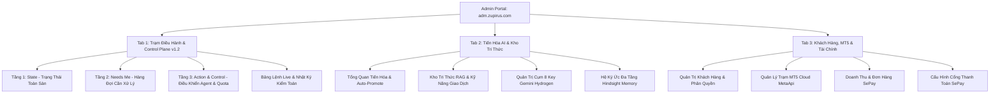

# BẢNG TỔNG MỤC RÀ SOÁT CỔNG QUẢN TRỊ ADMIN (ZUPIRUS QUANT LAB)
> **Phiên bản:** Admin Control Plane v1.2 (SRE & Quantitative Operations Standard)  
> **Cổng truy cập:** `https://adm.zupirus.com`  
> **Hạ tầng live:** Caddy Reverse Proxy -> Python FastAPI Engine (Container: `zupirus-prod-api-1`) -> React Vite Client  
> **Ngày rà soát:** 22/11/2026

---

## I. TỔNG QUAN KIẾN TRÚC GIAO DIỆN QUẢN TRỊ

Cổng Quản trị Trung tâm (`adm.zupirus.com`) được thiết kế theo tiêu chuẩn công thái học điều hành SRE & Quants, chia thành **3 Tab chính** với quy tắc phân cấp thông tin nghiêm ngặt:
1. **Tab 1: Trạm Điều Hành & Control Plane v1.2 (`AdminCommandRadarTab`)** — Giám sát hạ tầng, ra quyết định khẩn cấp, duyệt chiến lược, điều khiển nhịp tim AI và rollback 1-click.
2. **Tab 2: Tiến Hóa AI & Kho Tri Thức (`AdminAIEvolutionTab`)** — Giám sát học sâu Tabula Rasa, nạp tài liệu RAG, quản trị cụm 8 API Key Gemini Hydrogen và bộ nhớ Hindsight.
3. **Tab 3: Khách Hàng, MT5 Cloud & Tài Chính (`AdminBusinessCustomersTab`)** — Vận hành khách hàng, trạm Cloud MetaApi MT5, xử lý đơn hàng SePay và quản trị doanh thu.

---

## II. CHI TIẾT CÁC MỤC QUẢN LÝ THEO TỪNG TAB

---

### TAB 1: TRẠM ĐIỀU HÀNH & CONTROL PLANE V1.2 (`AdminCommandRadarTab.tsx`)

Tab này tổ chức theo **3 Tầng vận hành tiêu chuẩn SRE** giúp Admin nắm bắt trạng thái toàn sàn chỉ trong 5 giây và xử lý sự cố tức thì:

#### 1. Header Điều Khiển Nhanh
- **Chuyển đổi Chế độ Tín hiệu (Signal Mode Toggle):**
  - `EXTERNAL_FEED`: Tiếp nhận tín hiệu từ luồng bên ngoài.
  - `HYBRID_AGENT_SCORER`: Kết hợp tín hiệu kỹ thuật với AI chấm điểm xác suất.
  - `ZUPIRUS_AGENT`: AI tự trị hoàn toàn sinh tín hiệu và thực thi.
- **Trạng thái Phiên Thị Trường (Market Session):** Nhận diện phiên Á, Âu, Mỹ; cảnh báo thanh khoản thấp hoặc thị trường đóng cửa cuối tuần.
- **Nút `Chạy Dry-Run Test`:** Kiểm tra luồng tạo tín hiệu giả định, đo độ trễ và kiểm tra pipeline thực thi không rủi ro tài chính (`POST /api/v1/telemetry/dry-run`).
- **Nút `Cầu Dao Khẩn Cấp (Kill-Switch)`:** Ngắt toàn bộ hoạt động giao dịch tự động của toàn sàn ngay lập tức trong trường hợp thị trường biến động cực đoan (`POST /api/admin/system/kill-switch`).

#### 2. Tầng 1: State — Trạng Thái Toàn Sàn
- **Hạ Tầng 4 Node (4-Node Infrastructure Topology):**
  - `Node 01: TimescaleDB / PostgreSQL` — Giám sát latency DB (chuẩn ~1.2 ms), trạng thái hypertable quotes và ticks.
  - `Node 02: Redis Streams & Cache` — Giám sát memory, stream `signal_ticks` và latency cache (chuẩn ~0.7 ms).
  - `Node 03: Gemini 4 Hydrogen Cluster` — Trạng thái cụm 8 API key, hạn mức quota còn lại trong ngày.
  - `Node 04: MetaApi Cloud Datacenter` — Kết nối trạm G2 London datacenter, latency mạng tới broker (~24.0 ms).
- **6 Chỉ Số Vận Hành Cốt Lõi (Operational KPIs):**
  - `Tổng AUM (USD)`: Tổng vốn khách hàng kết nối qua nền tảng.
  - `Tài Khoản MT5 Đang Chạy`: Số tài khoản MT5 đang bật Auto-Trade.
  - `Lệnh Khớp Toàn Sàn (24h)`: Tổng số giao dịch đã thực hiện trong ngày.
  - `Chiến Lược AI Vận Hành`: Số chiến lược đang được phê duyệt chạy live.
  - `Hàng Đợi Cần Xử Lý`: Số tác vụ, chiến lược hoặc giao dịch cần Admin can thiệp.
  - `Macro News Shield`: Trạng thái lá chắn tin tức vĩ mô (vùng an toàn trước/sau tin đỏ ±30 phút).

#### 3. Tầng 2: Needs Me — Hàng Đợi Cần Xử Lý Ngay
- **Banner Trạng Thái Rảnh Rỗi:** Hiển thị `"Hệ thống vận hành ổn định — 0 PENDING ITEMS"` khi không có việc tồn đọng.
- **Cảnh Báo Quota AI $\ge 80\%$:** Nhắc nhở Admin hạn mức sắp chạm trần.
- **Đơn Nạp SePay Cần Duyệt Bù:** Hiển thị các đơn chuyển khoản sai nội dung hoặc thiếu tiền.
- **Hàng Đợi Duyệt Chiến Lược (`WAITING_APPROVAL`):**
  - Hiển thị danh sách chiến lược do Sub-Agent `alpha` và `research_wfo` tối ưu thành công.
  - **Bảng So Sánh Đối Chiếu Diff (Live Target vs Candidate):**
    - Win Rate hiện tại vs Đề xuất mới ($\Delta\%$).
    - Profit Factor hiện tại vs Đề xuất mới.
    - Tỷ lệ sụt giảm tối đa (Max Drawdown %).
    - Số mẫu backtest (Sample Size).
    - Quy tắc Sweep/Trigger và điều kiện nến kích hoạt.
  - **Nút Thao Tác:**
    - `✓ Duyệt Chạy LIVE`: Đưa chiến lược lên Production ngay (`POST /api/admin/strategies/approve`).
    - `✕ Từ Chối`: Hủy bỏ ứng viên khỏi hàng đợi (`POST /api/admin/strategies/reject`).

#### 4. Tầng 3: Action & Control — Điều Khiển Agent, Quota & Lịch Sử Phiên Bản
- **Bảng Nhịp Tim 4 Agent Vận Hành (Agent Heartbeat Grid):**
  - `sentinel` (Giám sát luồng nến và phát hiện thanh khoản/biến động).
  - `alpha` (Thuật toán săn mô hình và kích hoạt tín hiệu giao dịch).
  - `risk_guardian` (Bảo vệ tài khoản khách hàng, rà soát tin tức, tính toán lot size).
  - `research_wfo` (Tự học Tabula Rasa, tối ưu ngoài mẫu Walk-Forward Optimization).
  - *Mỗi Agent hiển thị:* Trạng thái (`IDLE`, `RUNNING`, `PAUSED`, `QUOTA_CAPPED`), chu kỳ chạy gần nhất, nhịp tim cuối (ms), tóm tắt kết quả chu kỳ.
  - *Bộ nút điều khiển:*
    - `⚡ Wake Now`: Đánh thức Agent chạy ngay lập tức. Sử dụng **Atomic Lock 60 giây trong Redis** chống chạy đè chu kỳ (`POST /api/admin/ops/agents/wake`).
    - `Tạm dừng / Bật lại`: Cho phép Admin ngưng tạm thời từng Agent mà không ảnh hưởng các Agent khác (`POST /api/admin/ops/agents/toggle-pause`).
- **Thanh Tiến Độ Quota Hạn Mức Gemini (Budget Guard):**
  - Giám sát hạn mức gọi API trong ngày (mặc định 144 lượt/ngày).
  - Phân rã số lượt gọi theo từng Agent (`sentinel`, `alpha`, `risk_guardian`, `research_wfo`).
  - Cảnh báo vàng khi $\ge 80\%$, khóa cứng đỏ (Hard Block) tại $100\%$ không phát sinh kết nối mạng tốn chi phí.
  - Nút `Mở khóa 60 phút` và nút `Đặt lại hạn mức hôm nay`.
- **Lịch Sử Phiên Bản Chiến Lược & Hoàn Tác 1-Click (`Rollback 1-Click`):**
  - Lưu trữ tối đa 10 phiên bản gần nhất (`APPROVED_FOR_PROD`, `ARCHIVED_PROD`, `ROLLED_BACK`, `PAUSED_DRAWDOWN_GUARD`).
  - Hiển thị ngày duyệt, người duyệt, thông số Win Rate / Profit Factor của từng phiên bản.
  - Nút `↺ Rollback 1-Click` kèm **Modal xác nhận an toàn**: Cho phép khôi phục tức thời phiên bản chiến lược ổn định trước đó nếu bản mới bị sụt giảm quá đà (`POST /api/admin/ops/strategies/rollback`).

#### 5. Giám Sát Thời Gian Thực & Kiểm Toán (Realtime Telemetry & Audit)
- **Bảng Lệnh Live Toàn Sàn (`AdminLiveOrdersPanel`):**
  - Xem danh sách lệnh mở/đóng realtime của toàn bộ khách hàng.
  - Bộ lọc: Trạng thái lệnh (Filled, Pending, Rejected, Closed), tìm kiếm theo Account ID / Ticket / Cặp tiền.
  - Đo độ trễ khớp lệnh từng giao dịch (Execution Latency ms).
- **Nhật Ký Kiểm Toán Hệ Thống (System Audit Log):**
  - Ghi nhận mọi thay đổi cấu hình, lượt wake agent, duyệt chiến lược, đổi mode tín hiệu.
  - Bộ lọc: Tất cả nhật ký hoặc Chỉ lọc Lỗi & Cảnh báo (`ERROR` / `WARN`).
  - Hỗ trợ bung xem chi tiết Payload JSON của từng hành động.
- **Trung Tâm Cảnh Báo Chủ Động (Actionable Alert Center):**
  - Cảnh báo sự kiện vĩ mô chuẩn bị diễn ra (CPI, Non-Farm Payrolls, Lãi suất FED).
  - Bộ đếm ngược thời gian kích hoạt Lá chắn Tin tức (News Shield).

---

### TAB 2: TIẾN HÓA AI & KHO TRI THỨC (`AdminAIEvolutionTab.tsx`)

Quản trị toàn bộ trí tuệ nhân tạo, khả năng tự học của hệ thống định lượng và cụm tài nguyên Gemini:

#### 1. Tổng Quan Tiến Hóa & Auto-Promote (`AdminAiOverviewPanel`)
- **Bộ Đo Tiến Trình Tự Học (Tabula Rasa Engine):**
  - Theo dõi tiến độ tích lũy 500 mẫu Shadow Signals để đạt mốc trưởng thành mô hình.
  - Tỷ lệ thắng thực nghiệm của AI qua các chu kỳ thị trường.
  - Số lượng kỹ năng tự đúc kết (`app/skills/learned`) song song với kỹ năng cốt lõi (`app/skills/core`).
- **Cơ Chế Tự Động Thăng Hạng (Auto-Promote Switch):**
  - Cho phép bật/tắt quyền tự động đưa chiến lược lên Production nếu thỏa mãn đồng thời:
    - Số mẫu backtest $\ge 30$ mẫu.
    - Win Rate $\ge 58\%$.
    - Profit Factor $\ge 1.5$.
    - Tỷ lệ sụt giảm tối đa (Max Drawdown) $\le 12\%$.
- **Hàng Đợi Walk-Forward Optimization (WFO Queue):**
  - Kiểm tra tính ổn định ngoài mẫu dữ liệu (Out-of-sample) để ngăn ngừa hiện tượng học vẹt (Overfitting).

#### 2. Nạp Tri Thức RAG & Quản Trị Kỹ Năng (`AdminAiKnowledgePanel`)
- **Hệ Thống Nạp Tài Liệu PDF (RAG PDF Ingestion Pipeline):**
  - Cho phép Admin tải lên tài liệu định lượng, sách chuyên ngành giao dịch, tài liệu phân tích kỹ thuật.
  - Pipeline 4 Agent tự động bóc tách, chuẩn hóa, phân đoạn và tạo vector embeddings (`POST /api/admin/skills/ingest-pdf`).
- **Quản Trị Thư Viện Kỹ Năng (Skills Management):**
  - Xem danh sách kỹ năng đang kích hoạt (ICT, SMC, Breakout, Mean Reversion).
  - Xem trực tiếp source code / logic định lượng của kỹ năng.
  - Xóa hoặc vô hiệu hóa các kỹ năng lỗi thời.

#### 3. Quản Trị Cụm 8 API Key Gemini Hydrogen (`AdminAiManualOverrideDrawer`)
- **Bảng Trạng Thái Cụm 8 Key:**
  - Hiển thị danh sách Key (được che bảo mật dạng `AIzaSy...****`).
  - Đếm tổng số lượt gọi API thực tế của từng key.
  - Nút `Ping Latency`: Đo độ trễ phản hồi thời gian thực của từng key (ms).
  - Công tắc Bật / Tắt hoạt động của từng key riêng lẻ.
  - Form thêm Key mới vào Pool với kiểm tra tính hợp lệ trước khi lưu.

#### 4. Hệ Ký Ức Đa Tầng Hindsight Memory (`AdminAiManualOverrideDrawer`)
- **Bộ Lưu Trữ Ký Ức Vector Hindsight:**
  - `Episodic Memory`: Ký ức theo từng phiên giao dịch cụ thể (sự kiện giá bất thường, bẫy giá).
  - `Semantic Memory`: Ký ức về quy luật thị trường, cấu trúc thanh khoản.
  - `Reflective Memory`: Ký ức đúc kết từ các lệnh thua (bài học quản trị rủi ro).
- **Công Cụ Quản Lý:**
  - Ô tìm kiếm ngữ nghĩa trong kho ký ức.
  - Nút thêm ký ức định lượng thủ công.
  - Nút xóa hoặc thanh trừng các ký ức sai lệch, chống nhiễu mô hình.

---

### TAB 3: KHÁCH HÀNG, MT5 CLOUD & TÀI CHÍNH (`AdminBusinessCustomersTab.tsx`)

Quản trị toàn bộ hoạt động kinh doanh, người dùng, tài khoản MetaTrader 5 và dòng tiền thanh toán:

#### 1. Quản Trị Khách Hàng & Phân Quyền (`customers`)
- **Danh Sách Người Dùng Toàn Sàn:**
  - Hiển thị ID, Tên, Email, Ngày đăng ký, Vai trò (`customer` / `admin`).
  - Trạng thái xác thực tài khoản.
- **Thao Tác Quản Trị:**
  - `Tạo người dùng mới`: Thêm trực tiếp người dùng từ Admin Portal.
  - `Thay đổi vai trò`: Nâng cấp người dùng thành `admin` hoặc hạ xuống `customer`.
  - `Cấp lại mật khẩu`: Tự động sinh mật khẩu ngẫu nhiên an toàn và gửi lại khách hàng.
  - `Xóa tài khoản`: Xóa sạch thông tin khách hàng và ngắt kết nối các tài khoản liên kết.

#### 2. Quản Lý Trạm MT5 Cloud MetaApi (`customers` / `accounts`)
- **Danh Sách Tài Khoản Giao Dịch Khách Hàng:**
  - Hiển thị Login MT5, Tên sàn môi giới (Broker Server), Loại tài khoản (Demo/Live), Đòn bẩy.
  - Trạng thái kết nối Cloud MetaApi (`CONNECTED`, `CONNECTING`, `DISCONNECTED`, `ERROR`).
  - Số dư (Balance), Vốn khả dụng (Equity), Mức ký quỹ (Margin).
- **Điều Khiển Giao Dịch Khách Hàng:**
  - Nút gạt `Bật / Tắt Auto-Trade`: Cho phép tạm dừng sao chép lệnh cho từng tài khoản cụ thể.
  - Xem chi tiết lỗi kết nối (sai pass investor, tài khoản bị khóa đòn bẩy,...).
  - Nút ngắt kết nối và gỡ bỏ tài khoản khỏi hệ sinh thái Cloud.

#### 3. Quản Trị Doanh Thu & Giao Dịch SePay (`orders`)
- **Thống Kê Doanh Thu:**
  - Tổng doanh thu thực nhận (VND).
  - Biểu đồ phân bổ doanh thu theo gói dịch vụ (Gói Tháng, Gói Quý, Gói Năm, Gói Trọn Đời).
- **Danh Sách Giao Dịch SePay:**
  - Mã đơn hàng (Order ID), Email khách hàng, Số tiền thanh toán, Ngân hàng chuyển tiền.
  - Mã tham chiếu ngân hàng (Reference Code) và cú pháp nội dung chuyển khoản.
  - Trạng thái đơn hàng: `PAID` (Đã thanh toán), `UNDERPAID` (Thiếu tiền), `FAILED` (Thất bại), `PENDING` (Đang chờ).
- **Xử Lý Sự Cố Thanh Toán (Manual Reconciliation):**
  - Nút `Duyệt bù thủ công`: Cho phép Admin kích hoạt dịch vụ cho khách hàng trong trường hợp khách chuyển khoản ghi nhầm nội dung hoặc thiếu số tiền nhỏ.

#### 4. Cấu Hình Cổng Thanh Toán SePay (`settings` / `AdminBillingSettingsTab.tsx`)
- **Thông Tin Tài Khoản Nhận Tiền:**
  - Số tài khoản ngân hàng thụ hưởng.
  - Tên ngân hàng nhận (Vietcombank, MBBank, Techcombank,...).
  - Tên chủ tài khoản thụ hưởng.
- **Bảo Mật Webhook SePay:**
  - Webhook URL nhận tín hiệu IPN tự động.
  - Secret Key xác thực chữ ký số SePay (được mã hóa chuẩn AES-GCM trong Database).

---

## III. DANH MỤC BACKEND API PHỤC VỤ CỔNG ADMIN

Dưới đây là toàn bộ các Endpoint API được phân quyền nghiêm ngặt (`role: admin`), chỉ mở trên cổng nội bộ và định tuyến qua Caddy:

| Nhóm Chức Năng | Phương Thức | Đường Dẫn Endpoint | Mô Tả Tác Vụ |
| :--- | :---: | :--- | :--- |
| **Control Plane v1.2** | `GET` | `/api/admin/ops/quota` | Lấy hạn mức và tiến độ gọi Gemini trong ngày |
| | `POST` | `/api/admin/ops/quota/override` | Mở khóa hạn mức khẩn cấp 60 phút hoặc reset |
| | `GET` | `/api/admin/ops/agents/heartbeats` | Lấy nhịp tim, chu kỳ và trạng thái 4 Agent |
| | `POST` | `/api/admin/ops/agents/toggle-pause` | Tạm dừng hoặc kích hoạt lại từng Agent |
| | `POST` | `/api/admin/ops/agents/wake` | Đánh thức Agent chạy ngay (khóa Atomic Lock 60s) |
| | `GET` | `/api/admin/ops/strategies/review-queue` | Lấy hàng đợi chiến lược kèm bảng so sánh Diff |
| | `POST` | `/api/admin/ops/strategies/rollback` | Hoàn tác chiến lược về phiên bản ổn định trước |
| **Hệ Thống & Khẩn Cấp** | `POST` | `/api/admin/system/kill-switch` | Kích hoạt cầu dao khẩn cấp ngắt toàn sàn |
| | `POST` | `/api/v1/telemetry/dry-run` | Chạy thử nghiệm luồng tín hiệu giả định |
| | `GET` | `/api/v1/telemetry/admin` | Thu thập toàn bộ telemetry, nến, AUM và lệnh sàn |
| **Chiến Lược AI** | `POST` | `/api/admin/strategies/approve` | Phê duyệt ứng viên chiến lược lên Production |
| | `POST` | `/api/admin/strategies/reject` | Từ chối và loại bỏ ứng viên chiến lược |
| | `POST` | `/api/admin/strategies/auto-promote` | Bật/tắt chế độ tự thăng hạng chiến lược |
| **Tri Thức & RAG** | `POST` | `/api/admin/skills/ingest-pdf` | Nạp tài liệu PDF sách trading vào Vector DB |
| | `GET` | `/api/admin/skills/list` | Liệt kê danh mục kỹ năng cốt lõi và tự học |
| **Cụm Key & Ký Ức** | `GET` | `/api/admin/keys/pool` | Xem danh sách và số lần gọi của 8 Key Gemini |
| | `POST` | `/api/admin/keys/ping` | Đo độ trễ thời gian thực của từng API Key |
| | `GET` | `/api/admin/memory/list` | Tìm kiếm và xem ký ức đa tầng Hindsight |
| | `DELETE`| `/api/admin/memory/{id}` | Xóa ký ức lỗi gây sai lệch quyết định giao dịch |
| **Khách Hàng & MT5** | `GET` | `/api/admin/users/list` | Liệt kê danh sách người dùng và tài khoản MT5 |
| | `POST` | `/api/admin/users/create` | Tạo mới người dùng từ trang quản trị |
| | `PUT` | `/api/admin/users/{id}/role` | Cập nhật vai trò người dùng (`admin` / `customer`) |
| | `POST` | `/api/admin/accounts/{id}/toggle` | Bật/tắt trạng thái Auto-Trade của tài khoản MT5 |
| **Thanh Toán & Cấu Hình**| `GET` | `/api/admin/billing/orders` | Danh sách giao dịch SePay và thống kê doanh thu |
| | `POST` | `/api/admin/billing/reconcile` | Duyệt bù thủ công cho giao dịch thiếu/sai mã |
| | `POST` | `/api/admin/billing/settings` | Cập nhật số tài khoản nhận tiền và Secret Webhook |

---

## IV. CÁC HÀNG RÀO BẢO VỆ AN TOÀN VẬN HÀNH (SAFETY GUARDRAILS)

1. **Perimeter Domain Isolation:** Cổng Admin chạy độc lập trên `adm.zupirus.com` với quy tắc Caddy và Content Security Policy (CSP) nghiêm ngặt, chặn mọi truy cập trái phép từ User Portal (`app.zupirus.com`).
2. **Atomic Lock 60s (`wake_agent`):** Ngăn chặn hoàn toàn tình trạng Admin click liên tục hoặc hệ thống bị race-condition kích hoạt trùng chu kỳ phân tích của Agent.
3. **Budget Guard 2 Cấp (80% / 100%):** Báo động vàng tại 80% quota và ngắt kết nối cứng tại 100% quota, trả về mã trạng thái nội bộ `QUOTA_CAP_REACHED` mà không gọi ra ngoài internet, chống cạn kiệt tài nguyên API.
4. **1-Click Rollback An Toàn:** Lưu vết 10 phiên bản chiến lược gần nhất, luôn có modal xác nhận trước khi khôi phục, đảm bảo không làm gián đoạn các lệnh đang mở.
5. **Redaction Tuyệt Đối:** Mọi mật khẩu MT5, khóa bí mật SePay, chuỗi API Key Gemini đều được băm hoặc che mờ (`AIzaSy...****`) trước khi gửi về giao diện Admin.
