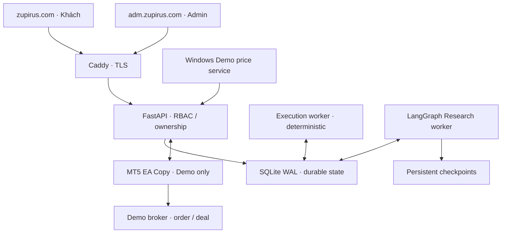

# Kiến trúc và quyết định thiết kế

## Phạm vi

Một VPS, một replica API, một Execution worker, một Research worker. SQLite WAL + transaction `BEGIN IMMEDIATE` serialize mutations, có foreign keys và unique constraints. Dữ liệu ứng dụng và LangGraph được lưu trong volume `lab_data`. Đây là lựa chọn triển khai Demo nhỏ, không phải kiến trúc HA đa vùng. Khi mở rộng cần PostgreSQL, migrations có version và PostgreSQL LangGraph checkpointer cùng distributed leasing.

Execution không import LangGraph hoặc gọi LLM; worker Research dừng không gây dừng Execution. Các tiến trình cùng dùng một image có phiên bản dependency được khóa; tách biệt là theo tiến trình và đường gọi, không phải miền bảo mật riêng giữa các tenant trên cùng VPS.

## Thực thi

- Price service có bearer token riêng chỉ được phép nạp `DEMO`. Timestamp cũ hơn 10 giây, future quá 10 giây, bid/ask ngược bị từ chối. Symbol feeder phải là XAU/USD và account terminal là Demo.
- Chiến lược minh họa: SMA nhanh 5 / chậm 20, phát tại giao cắt; SL 6 USD/oz, TP 12 USD/oz. Không có hứa hẹn alpha hoặc lợi nhuận. Chưa có portfolio optimizer hay strategy marketplace.
- Mỗi quote timestamp và signal source/key được deduplicate. Dispatch unique `(account_id, signal_id)`.
- Rủi ro backend: copy flag, môi trường, heartbeat, TTL, spread, số lệnh/intent, drawdown trên equity peak, tiền rủi ro dự kiến, lịch tin và system halt.
- EA dùng giá broker thực; tính lot bằng `OrderCalcProfit`, floor về step; không nâng lên min lot nếu vượt budget. Kiểm tra margin, spread, slippage/drift, stop level, filling mode, tổng vị thế/lệnh pending và `OrderCheck`.
- Lot sizing dùng 90% budget để chừa phí/slippage. Đây không phải bảo đảm lỗ tối đa khi gap thị trường.
- Lệnh thoát do SL/TP broker xử lý. Pause ngăn lệnh mới, không tự đóng vị thế đã có. Bản này không phát lệnh đóng/sửa SL từ trung tâm.

## Replay

900 bar tổng hợp được phát 2 giây/bar, tự lặp; khi vòng lặp reset, các vị thế mô phỏng còn lại được đóng theo giá bar mới. Contract mô phỏng cố định 100 oz/lot, tài khoản USD, spread 0.30 USD/oz, phí 7 USD/lot. Replay không mô phỏng order book, gap intrabar, latency phân phối thực tế hoặc đặc tính riêng của broker.

Balance/Equity lấy từ bảng snapshot; không bịa đường equity. Snapshot giữ 7 ngày, quote giữ 2 ngày; signals/receipts/audit/checkpoints được giữ để đối soát. Admin phải giám sát dung lượng đĩa.

## LangGraph

`START → walk_forward → admin_review (interrupt) → archive → END`.

- `thread_id=job.id`, `SqliteSaver` dùng file riêng `/data/research.sqlite3`.
- Queue/job decisions ở `/data/lab.sqlite3`. Worker mở lại checkpoint sau restart; nếu graph đã hoàn tất nhưng queue chưa cập nhật thì khôi phục kết quả, không chạy lại phê duyệt.
- WFO rolling 120 bar train / 60 bar OOS, 13 folds, chọn fast SMA trong 3/5/8 chỉ trên train; slow=20, cùng họ chiến lược Execution. OOS không chồng lấn. Fills giả lập tại bar tiếp theo, barrier đánh giá trên close, đóng còn lại cuối fold, phí 0.37 price-unit mỗi round trip.
- Không dùng thông tin tương lai để chọn tham số. Có test thay toàn bộ tương lai rồi xác minh fold trước không đổi.
- Metrics theo **price units**, không phải phần trăm lợi nhuận khách. Mọi report có `production_qualified=false` vì dữ liệu tổng hợp chưa chứng minh chiến lược trên broker.
- Admin duyệt chỉ lưu ứng viên `approved_for_demo_review`; muốn thay chiến lược cần quy trình thay mã, test và triển khai riêng.

## AI và lịch kinh tế

Vision dùng endpoint chat completions có ảnh; nhận PNG/JPEG do Admin gửi, giới hạn kích thước. Trợ lý chỉ nhận dashboard của user từ SQL có filter owner; không có tools ghi dữ liệu/giao dịch. Khi không có key hoặc provider lỗi, trợ lý dùng trả lời quy tắc, Vision thông báo không khả dụng. API key không được chuyển xuống browser, EA hay Execution worker.

Lịch tin được nhập bởi Admin. Bộ lọc USD/ALL + high impact là quyết định xác định, không phụ thuộc LLM. Chưa có nguồn tin realtime mặc định hoặc lời khẳng định rằng lịch trống đồng nghĩa không có tin.

## Cơ sở tham chiếu kỹ thuật

- LangGraph interrupt/persistence: https://docs.langchain.com/oss/python/langgraph/interrupts
- MT5 OrderSend và ý nghĩa kết quả: https://www.mql5.com/en/docs/trading/ordersend
- MT5 HistorySelect: https://www.mql5.com/en/docs/trading/historyselect
- Account trade mode: https://www.mql5.com/en/docs/constants/environment_state/accountinformation

OrderSend trả true chưa chứng minh đã khớp. Hệ thống chỉ ghi `filled` khi có order ticket và deal từ đối soát broker của EA.
