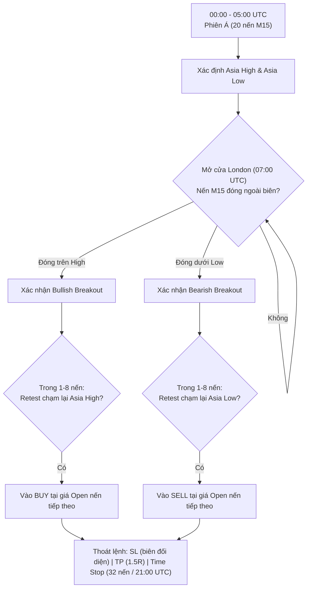

# ZUPIRUS Gold Research Suite v1: Hướng Dẫn Vận Hành & Tái Lập Kết Quả (Quickstart Guide)

> **Bản quyền**: © 2026 ZUPIRUS Quant Lab. Mọi quyền được bảo lưu.  
> **Sản phẩm**: ZUPIRUS Gold Research Suite v1 — Phân Tích Định Lượng Breakout & Retest Vàng M15  
> **Tài sản nghiên cứu**: Hợp đồng tương lai vàng COMEX (COMEX Gold Futures - `GC=F`)  
> **Phạm vi giấy phép**: Giấy phép dùng thử đánh giá nội bộ dành cho một đội ngũ tổ chức (Single-Team Institutional Evaluation License).  
> **Mục tiêu định giá**: $10,000 USD (Mức giá chào mục tiêu của chủ dự án; cổng thanh toán công khai hiện được tắt để ưu tiên cấp quyền dùng thử có kiểm soát).

---

## 1. Giới Thiệu & Thành Phần Bàn Giao

**ZUPIRUS Gold Research Suite v1** là bộ ấn phẩm nghiên cứu định lượng độc lập được phát triển trước bởi ZUPIRUS Quant Lab. Toàn bộ phương pháp, mã nguồn kiểm định, dữ liệu đầu vào và nhật ký giao dịch được chuẩn hóa để một phiên bản duy nhất có thể được chuyển giao và tái lập độc lập bởi nhiều đội ngũ tổ chức mà không yêu cầu tài khoản broker hay kết nối sàn bên thứ ba.

### Trọn bộ gói bàn giao bao gồm:
1. **Báo cáo nghiên cứu định lượng PDF**:
   - `Bản đọc thử (Sample PDF)`: Tóm tắt điều hành, giả thuyết vi cấu trúc, khung thời gian và thông số tổng quan.
   - `Bản đầy đủ (Full Research PDF)`: Chi tiết kiểm định 3 pha (Train 50%, Walk-Forward 30%, Holdout 20%), phân tích ý nghĩa thống kê ($t$-statistic, $p$-value), ma trận nhạy chi phí ma sát (0, 3.5, 5.0 pips), mô phỏng rủi ro đuôi Monte Carlo ($P95$ Drawdown) và các điều kiện khiến lợi thế suy yếu.
2. **Nhật ký giao dịch gốc (`ledger.csv`)**:
   - Từng giao dịch mô phỏng đều có mã định danh `trade_id`, thời điểm vào/thoát chuẩn UTC, giá mô phỏng, phân tập dữ liệu (`TRAIN`, `WALK_FORWARD`, `HOLDOUT`), chi phí giả định, lý do thoát (`TAKE_PROFIT`, `STOP_LOSS`, `TIME_STOP`, `SESSION_CLOSE`), Gross PnL và Net R.
3. **Công cụ Replay độc lập (`cli.replay`)**:
   - Chạy trực tiếp từ dòng lệnh hoặc qua giao diện web sandbox, không cần tài khoản broker. Cho phép đội ngũ của bạn nạp dữ liệu nến OHLCV nội bộ, tùy chỉnh giả định spread và trượt giá.
4. **Bộ dữ liệu mẫu được chứng thực (`data/samples/comex_gold_m15_sample.csv`)**:
   - Dữ liệu lịch sử 500 nến M15 chuẩn hóa UTC kèm mã băm SHA-256 để đối chiếu tính toàn vẹn.

---

## 2. Quy Tắc Định Lượng Breakout & Retest M15 (Phiên Bản Khóa v1)

Chiến lược tuân thủ nghiêm ngặt nguyên tắc **Point-in-Time** (chỉ sử dụng thông tin đã đóng nến tại thời điểm ra quyết định, tuyệt đối không rò rỉ dữ liệu tương lai):



### Các quy tắc phòng vệ bảo toàn:
- **Xử lý cùng nến (Same-bar SL/TP)**: Nếu trong một cây nến biên độ giá chạm cả mức Cắt Lỗ (SL) và Chốt Lời (TP), hệ thống luôn giả định bảo thủ là **Cắt Lỗ kích hoạt trước** (ghi nhận $-1.0R$).
- **Xử lý chênh lệch giá mở cửa (Gap Open)**: Nếu nến mở cửa nhảy vọt qua SL hoặc TP, lệnh được khớp tại giá `Open` thực tế thay vì giá lý thuyết.
- **Thời gian thoát (Time Stop)**: Vị thế được nắm giữ tối đa 32 cây nến M15 (8 giờ) hoặc tự động đóng tại giá đóng cửa 21:00 UTC (kết thúc phiên Mỹ).
- **Mô hình chi phí**: Mặc định 3.5 pips ($0.35/oz) bao gồm spread và trượt giá trung bình.

---

## 3. Hướng Dẫn Tái Lập Với Bộ Dữ Liệu Mẫu

### Bước 1: Kiểm tra môi trường
Yêu cầu Python 3.10 trở lên. Không yêu cầu cài đặt thư viện bên ngoài nặng.
```bash
python --version
```

### Bước 2: Chạy công cụ Replay trên tập nến mẫu
Chạy lệnh sau từ thư mục gốc của dự án:
```bash
python -m cli.replay --input data/samples/comex_gold_m15_sample.csv
```

### Kết quả chuẩn mực kỳ vọng:
```text
==============================================================================
  ZUPIRUS QUANT LAB - GOLD RESEARCH SUITE V1 REPLAY DESK
  Quantitative Breakout & Retest M15 Backtest & Deterministic Ledger
==============================================================================
 Asset Class       : COMEX_GOLD_FUTURES
 Symbol (Source)   : GC=F (Hợp đồng tương lai vàng COMEX (COMEX Gold Futures - GC=F))
 Provider / Source : Yahoo Finance / COMEX
 Timeframe / Zone  : M15 / UTC
 Sample Window     : 2026-09-17 04:00:00 UTC  ->  2026-09-24 13:30:00 UTC
 Total Candles     : 500 bars (deduped 0 duplicates)
 Dataset SHA-256   : fe1c3d5a9f2d54c9c083b11cff4e2db668f93d2d2afeb5e9870d0b4156fbf53b
------------------------------------------------------------------------------
 Total Trades (N)  : 6          | Win Rate (%)       : 50.0%
 Profit Factor     : 2.01       | Expectancy (R)     : +0.1702R
 Net Realized (R)  : 1.02R      | Max Drawdown (R)   : 0.84R
==============================================================================
```

### Bước 3: Xuất nhật ký giao dịch chi tiết ra CSV
Để phân tích chuyên sâu bằng Excel, Python hoặc R:
```bash
python -m cli.replay --input data/samples/comex_gold_m15_sample.csv --output-ledger my_sample_ledger.csv
```

---

## 4. Kiểm Thử Với Bộ Dữ Liệu Riêng Của Đội Ngũ Bạn

Đội ngũ khách hàng có thể kiểm định quy tắc trên dữ liệu tick/M15 độc quyền của mình.

### 4.1 Định dạng tệp CSV hợp lệ
Tệp CSV cần có các cột sau (không phân biệt chữ hoa/thường):
```csv
time,datetime,open,high,low,close,volume
1789617600,2026-09-17 04:00:00 UTC,4334.2,4335.1,4331.2,4332.2,424
1789618500,2026-09-17 04:15:00 UTC,4332.4,4334.1,4329.4,4330.0,513
```
- `time`: Unix timestamp tính bằng giây theo múi giờ **UTC**.
- `open, high, low, close`: Giá số dương, `high` $\ge \max(\text{open}, \text{close})$ và `low` $\le \min(\text{open}, \text{close})$.
- `volume`: Khối lượng giao dịch.

### 4.2 Cơ chế tự động kiểm tra lỗi dữ liệu của công cụ
Công cụ `cli.replay` tự động thực hiện:
- **Khử trùng lặp (Deduplication)**: Phát hiện và loại bỏ các cây nến có trùng `timestamp`.
- **Sắp xếp theo trình tự thời gian**: Tự động sắp xếp từ quá khứ đến hiện tại để tránh đảo lộn thứ tự.
- **Cảnh báo dữ liệu rỗng**: Báo lỗi chi tiết nếu nến bị thiếu giá hoặc có giá $\le 0$.

### 4.3 Tùy biến chi phí ma sát thực tế của sàn bạn
Nếu sàn môi giới của bạn có spread trung bình là 4.0 pips và trượt giá ước tính 1.5 pips:
```bash
python -m cli.replay --input du_lieu_khach_hang.csv --spread-pips 4.0 --slippage-pips 1.5 --output-ledger ledger_khach_hang.csv
```

---

## 5. Quy Trình Cấp Quyền Dùng Thử Dành Cho Admin

Để bàn giao bản dùng thử cho một đội ngũ khách hàng tổ chức:
1. Tạo hoặc xác định tài khoản người dùng của đối tác trong hệ thống (qua email).
2. Gọi API quản trị cấp quyền dùng thử:
   ```http
   POST /api/v1/admin/reports/rep_gold_research_suite_v1/entitlements/grant-trial
   Content-Type: application/json
   Authorization: Bearer <ADMIN_TOKEN>

   {
     "email": "partner_team@institution.com",
     "version": "v1.0",
     "notes": "Single-Team 14-day Evaluation License"
   }
   ```
3. Sau khi cấp quyền, tài khoản đối tác có thể truy cập `Thư Viện Của Tôi (My Library)` trên website để tải bản PDF đầy đủ và tệp bằng chứng bất kỳ lúc nào.

---

## 6. Lưu Ý Pháp Lý & Giới Hạn Nghiên Cứu

> [!WARNING]
> **Giới hạn nguồn dữ liệu**: Toàn bộ dữ liệu của Gold Research Suite v1 được kiểm định trên Hợp đồng tương lai vàng COMEX (`GC=F`). Dữ liệu tương lai có đặc thù thanh khoản, chi phí rollover và biên độ lệch basis so với vàng giao ngay (XAU/USD Spot) hoặc hợp đồng chênh lệch (CFD). Không được dùng kết quả này để bảo đảm hay cam kết lợi nhuận trên thị trường Spot khi chưa có dữ liệu tick Spot trực tiếp tương ứng.

> [!IMPORTANT]
> **Tính độc lập định lượng**: ZUPIRUS Quant Lab là đơn vị nghiên cứu toán học định lượng thuần túy. Hệ thống không ủy thác đầu tư, không cung cấp tài khoản MT5/MetaApi tự động giao dịch và không cam kết tỷ suất sinh lời cố định.
