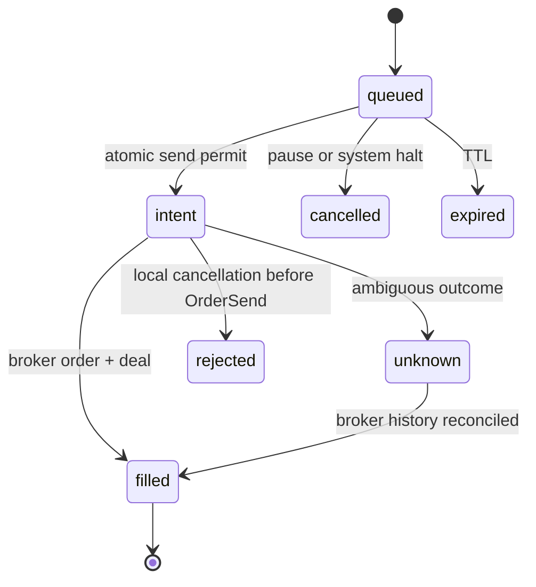

# Giao thức EA và idempotency

## Định danh và credential

Web session: cookie HttpOnly, SameSite=Strict, Secure ở public, 8 giờ. POST/PUT từ web phải có `X-Zupirus: 1`; Origin phải nằm trong allowlist. Device dùng bearer riêng, hash SHA-256 tại DB. Feed service dùng token riêng trong môi trường. Password dùng scrypt với salt ngẫu nhiên.

Khai báo tài khoản qua web không xác minh broker trực tiếp. Ghép nối đòi hỏi mã 256-bit có hiệu lực 5 phút do đúng owner tạo và bộ `(login, server, DEMO)` đúng hoàn toàn. EA lấy định danh từ `AccountInfo*`. Account/server unique toàn hệ thống. Việc này chứng minh người cầm mã đang ghép một terminal tự khai đúng định danh; không phải attestation mật mã từ broker.

Các request EA đều có JSON `{login, server, mode:"DEMO"}` và bearer token (trừ pair). Không chấp nhận REAL/CONTEST/REPLAY trên endpoint EA. Thu hồi device xóa token, hủy mã và pause tài khoản; intents chưa rõ vẫn nằm trong DB.

## Endpoints

| Endpoint | Kết quả / nội dung thêm |
|---|---|
| POST `/api/ea/pair` | Thêm `code`; trả token text một lần. Lưu token vào FILE_COMMON; nếu mất phản hồi pair, owner phải thu hồi và ghép lại. |
| POST `/api/ea/heartbeat` | Thêm balance/equity/positions; trả `OK`. Positions bao gồm cả pending orders. |
| POST `/api/ea/next` | `NONE` hoặc chuỗi 13 trường bên dưới. |
| POST `/api/ea/intent` | dispatch, nonce, spread USD/oz, risk_amount theo tiền tài khoản. Trả `SEND_ONCE` duy nhất lần đầu hoặc `RECONCILE`. |
| POST `/api/ea/report` | dispatch, nonce, state=filled/unknown/rejected, ticket, deal, reason. Filled đòi cả ticket/deal >0. |

Trường `/next` theo đúng thứ tự:

`id|state|side|reference_price|sl|tp|expiry_unix_utc|web_risk_pct|web_max_spread|web_max_positions|web_max_dd|nonce_or_dash|peak_equity`

Nonce không được dùng làm quyền gửi lại. Backend không trả `SEND_ONCE` lần hai dù nonce giống hệt. Đơn vị spread/SL/TP là giá USD/oz, không phải broker points.

## Máy trạng thái

Receipt cuối `filled` immutable; lặp chính xác được trả OK. Deal unique trong một tài khoản. Unknown/intent tiếp tục được `/next` trả về dù pause hoặc hết TTL để EA đối soát.

## Khôi phục

1. Khóa file exclusive theo account/server ngăn hai EA cùng host sử dụng cùng credential.
2. Trước một fresh send, kiểm tra history orders, deals, positions, pending orders theo `MAGIC_BASE + dispatch.id`. History chưa khả dụng thì không gửi.
3. Ghi và flush file intent trước khi gọi `/intent`. Không xóa intent sau khi báo cáo.
4. Chỉ response `SEND_ONCE` mới cho phép một lần `OrderSend`. Lặp HTTP authorization không được gửi lại.
5. Khi restart/đứt mạng, backend trả intent cùng nonce. EA dò lịch sử broker; tìm deal entry và order ticket để báo cáo.
6. Nếu không có bằng chứng khớp, giữ unknown; không suy luận “chưa thấy deal” thành “chưa từng gửi”. Nếu chỉ có một partial fill, báo deal entry đầu tiên ổn định, không gửi bù volume.

Mô hình cung cấp **at-most-once send theo dispatch trên dữ liệu bền vững**, có thể bỏ lỡ lệnh để tránh trùng. Không thể hứa “exactly once” tuyệt đối giữa hệ thống HTTP và broker không hỗ trợ transaction/idempotency chung. Test Python chứng minh mô hình giao thức, không thay thế nghiệm thu MQ5/broker.

## Những thao tác bị cấm trong vận hành

- Không reset dispatch về queued, không cấp lại send permit, không xóa journal để “thử lại”.
- Không clone/rollback DB hoặc phục hồi backup rồi bật EA ngay khi broker còn lệnh chưa đối soát.
- Không đổi MAGIC_BASE hoặc chỉnh EA bỏ kiểm tra Demo/risk/identity.
- Không chuyển credential sang tài khoản khác.

Unknown có thể khóa khả năng cấp lệnh mới vô thời hạn (fail closed). Bản này không cung cấp nút tự động “clear unknown”. Quản trị phải đối chiếu đầy đủ lịch sử broker và bản sao dữ liệu trước khi thiết kế thao tác phục hồi; không giải quyết bằng gửi lại lệnh cũ.
